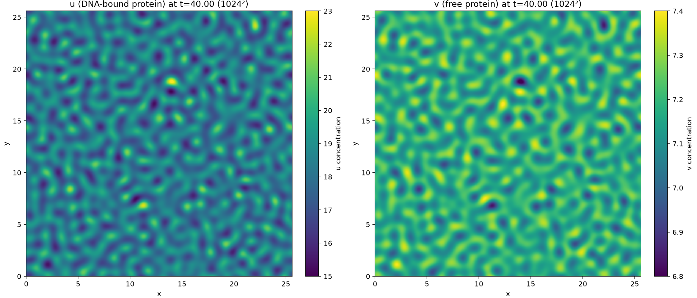

# DNA-p53 MCRD Accelerated

An experimental Python package for the DNA-p53 mass-conserving reaction-diffusion (MCRD) model and Local Pattern Properties (LPP) image analysis.

> **Status: experimental Alpha, not yet published.** NumPy is the reference backend. A bounded H100 MIG smoke, NumPy parity check, and repeated MCRD timing are now recorded for JAX CUDA. The measured speedups apply only to the listed MIG slice and configurations; they are not portable performance guarantees. Metal and Ascend C remain unvalidated. See the [backend matrix](docs/backend-matrix.md) and [H100 validation report](docs/h100-validation.md).

The repository is [`kingsley-wade/MCRD-accerlate`](https://github.com/kingsley-wade/MCRD-accerlate). The Python distribution is named `mcrd-accel`, and its import package is `mcrd_accel`.

## Install

The core package and NumPy reference backend:

```bash
uv sync
```

For development, tests, JAX CPU, and optional analysis tools:

```bash
uv sync --extra dev
```

LPP connected-component filtering with the default `min_patch_size > 1` requires SciPy from the `analysis` extra. Install it with:

```bash
uv sync --extra analysis
```

Apple Metal and CUDA extras are experimental and do not by themselves establish validated device support.

## MCRD Example

```python
from mcrd_accel.config import SolverConfig
from mcrd_accel.mcrd import run

config = SolverConfig.fig2b(
    Nx=64,
    Ny=64,
    dx=0.2,
    dy=0.2,
    dt=1e-5,
    n_steps=100,
)
result = run(config, checkpoint_stride=25)
print(result.metadata["final_mass"])
```

Select a JAX backend explicitly with `backend=Backend.JAX_CPU` or `Backend.JAX_CUDA`; a requested unavailable device raises an error instead of falling back silently.

## LPP Example

```python
import numpy as np

from mcrd_accel.config import LPPConfig
from mcrd_accel.lpp import analyze

y, x = np.mgrid[:128, :128]
image = np.cos(2 * np.pi * x / 16.0)
result = analyze(
    image,
    LPPConfig(w=32, dL=8, minL=4, maxL=24, batch_size=16),
)
print(result.wavelength.shape, result.validity.sum())
```

LPP currently runs on NumPy. MATLAB parity on representative experimental images is not yet established; see [LPP behavior and parity status](docs/lpp-parity.md).

## Validation and Benchmarks

Run the test suite and bounded local MCRD validation:

```bash
uv run pytest -q
uv run python scripts/validate_mcrd.py
uv run python scripts/validate_specs.py
```

Run workload benchmarks:

```bash
uv run python benchmarks/run_mcrd.py --case p53_mcrd --grid-sizes 64,128 --steps 1000
uv run python benchmarks/run_lpp.py --size 512 --window 64 --stride 8
```

The local artifacts under `reports/` are smoke evidence, not portable performance guarantees. `tracemalloc` records Python allocator peaks and excludes total process RSS and device memory. Hardware-specific results require attributable device/runtime metadata.

### NumPy reference versus H100 JAX CUDA

The bounded H100 MIG comparison used the same deterministic p53 MCRD inputs, float32, 200 steps, two warmups, and five timed repeats. CUDA wall time includes input and final-state transfers; first-call time (including JAX compilation) is reported separately.

| Grid | NumPy mean | JAX CUDA mean | NumPy/CUDA ratio |
| --- | ---: | ---: | ---: |
| 128 × 128 | 45.6 ms | 4.93 ms | 9.26× |
| 256 × 256 | 146.0 ms | 5.23 ms | 27.90× |

These measurements were made on one NVIDIA H100 3g.40gb MIG instance. The exact inputs, parity errors, timing samples, device details, and memory snapshots are in [`reports/h100-validation-20261030/`](reports/h100-validation-20261030/); see the [interpretation limits](docs/h100-validation.md).

### Matched JAX CPU versus H100

This short-run comparison used identical JAX/JAXlib versions, float64 inputs, seed, timestep, and 10,240 steps per grid. The CPU process was pinned to 8 ACP cores. Each grid had one warmup and three timed repeats; values below are steady-state medians.

| Grid | JAX CPU (s) | JAX CUDA H100 (s) | CPU/H100 speedup |
| ---: | ---: | ---: | ---: |
| 64² | 0.1892 | 0.1164 | 1.63× |
| 128² | 0.7290 | 0.1166 | 6.25× |
| 256² | 5.2434 | 0.1174 | 44.65× |
| 512² | 27.3653 | 0.1160 | 235.94× |
| 1024² | 113.1891 | 0.3032 | 373.29× |
| 2048² | 130.7076 | 1.1001 | 118.81× |
| 4096² | 603.6509 | 4.1021 | 147.16× |

This is a matched short-run benchmark, not a full t=40 workflow timing. The [runtime comparison](docs/runtime-comparison.md) documents the protocol, estimates, and differences from the legacy OpenCL workload.

### OpenCL migration example

The original OpenCL notebook recorded 168.1 seconds on an Apple M2 Ultra at 256². That historical run is not directly comparable to the JAX CPU/H100 table: its step count, spacing, dtype, device, and update behavior differ. The 1024² JAX CUDA figure below reproduces a similar random-field morphology; the [migration guide](docs/opencl-migration-guide.md) explains the configuration mapping.

| Runtime reference | Grid and updates | Time | Evidence |
| --- | --- | ---: | --- |
| OpenCL, Apple M2 Ultra | 256², 1,484,901 kernel launches | 168.1 s | One recorded run |
| JAX CPU, ACP 8-core allocation | 256², same step count | ~760 s | Linear estimate from the 10,240-step median |
| JAX CUDA, H100 MIG | 256², 1,392,640 steps | 17.95 s | Recorded run; scaling to 1,484,901 steps gives ~19 s |

These rows are a cross-device runtime reference, not a controlled speedup claim. The [detailed comparison](docs/runtime-comparison.md) shows the source settings and scaling method.



The [JAX CUDA guide](docs/jax-guide.md) gives the device check, solver example, and ACP commands. The full 4096² field archive is kept out of the normal Git history; see the runtime report for its measurements and provenance.

## Documentation

- [Numerical methods and local validation](docs/numerical-methods.md)
- [Backend support matrix](docs/backend-matrix.md)
- [JAX CUDA guide](docs/jax-guide.md)
- [CPU, OpenCL, and JAX runtime comparison](docs/runtime-comparison.md)
- [OpenCL migration guide](docs/opencl-migration-guide.md)
- [LPP behavior and parity status](docs/lpp-parity.md)
- [Canonical PDE verification cases](docs/pde-case-matrix.md)
- [H100 validation procedure and current status](docs/h100-validation.md)
- [GitHub release roadmap](docs/github-release-roadmap.md)
- [Complete project development plan](docs/project-development-plan.md)
- [Contributing and release checks](CONTRIBUTING.md)

## Development

```bash
uv sync --extra dev
uv run pytest -q
uv build
```

See [CONTRIBUTING.md](CONTRIBUTING.md) before opening a pull request. The project is licensed under the MIT License; see [LICENSE](LICENSE).
